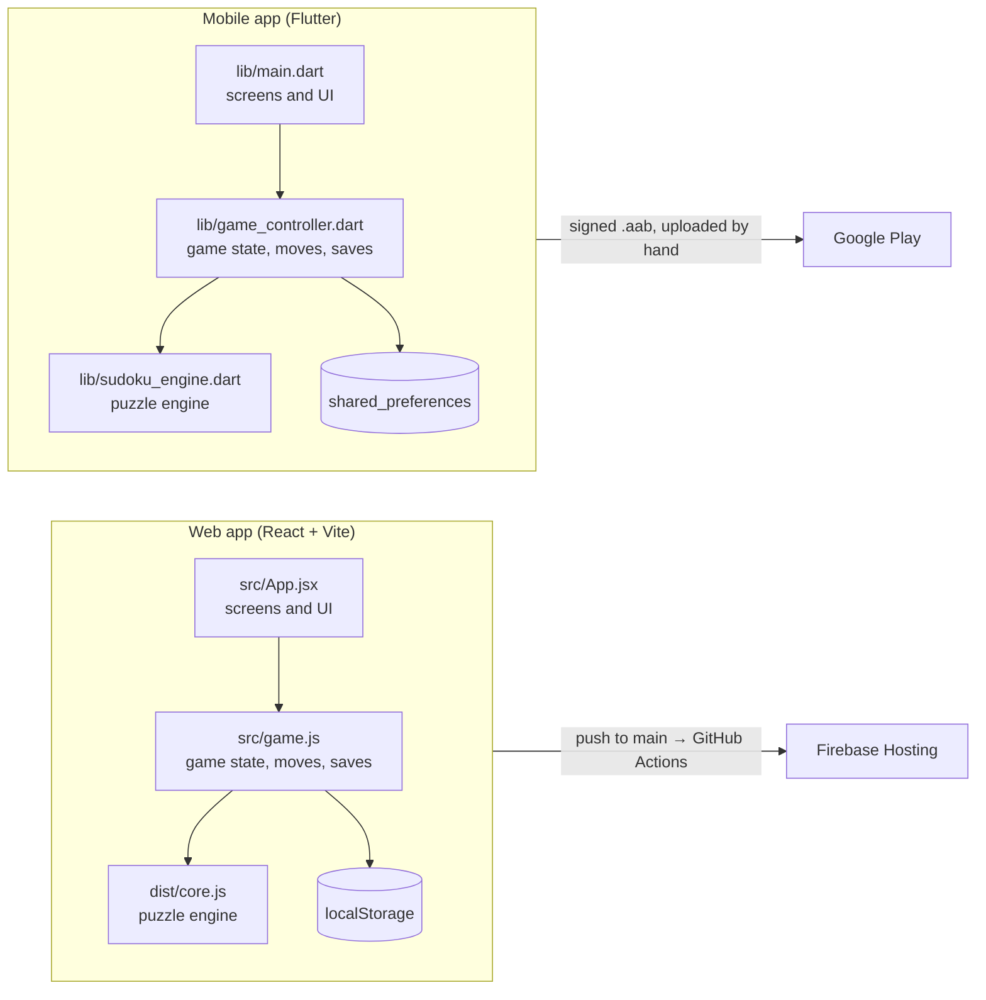
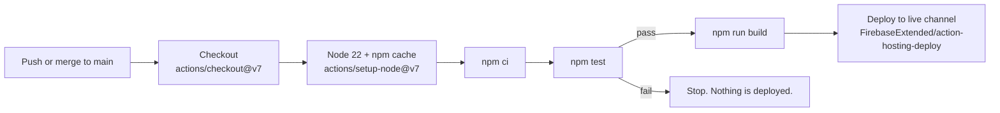

# Chachu's Sudoku

A calm Sudoku game for the web, Android and iOS.

- **Web:** React + Vite, hosted on Firebase Hosting at https://chachus-sudoku-2026.web.app
- **Mobile:** Flutter app in [`mobile/`](mobile/README.md), published on Google Play as `com.shibinnvc.chachussudoku`

Both apps work fully offline, need no account, and collect no data. Each one saves the current puzzle and game history on the device.

## Contents

- [Quick start](#quick-start)
- [Architecture](#architecture)
- [Firebase](#firebase)
- [CI/CD](#cicd)
- [Releasing the Android app](#releasing-the-android-app)
- [Delivery tickets](#delivery-tickets)

## Quick start

### Web

Requires Node.js 22 or newer.

```sh
npm install
npm run dev      # local dev server
npm test         # engine and game-state tests (node --test)
npm run build    # production build into build-web/
```

### Mobile

Requires Flutter 3.44 or newer.

```sh
cd mobile
flutter pub get
flutter run
flutter test
```

## Architecture



The web and mobile apps are separate implementations of the same design. They share no code at runtime, and saves don't sync between them.

### Layers

Each app has the same three layers:

| Layer | Web | Mobile | Responsibility |
| --- | --- | --- | --- |
| Engine | `dist/core.js` (re-exported by `src/core.js`) | `lib/sudoku_engine.dart` | Pure functions: generate a full solution, remove clues while checking the puzzle still has exactly one solution, find candidates and conflicts |
| Game state | `src/game.js` | `lib/game_controller.dart` (`ChangeNotifier`) | Current game, notes, undo/redo history, hints, timer, completion, saving and loading |
| UI | `src/App.jsx`, `src/styles.css` | `lib/main.dart` | Welcome, difficulty, puzzle and history screens |

The engine has no dependencies and does no input/output, so it's the most heavily tested part.

### Puzzle generation

1. Build a random valid solution. Start from a fixed valid Sudoku pattern, then shuffle the row bands, the rows within each band, the column stacks, the columns within each stack, and the digits 1–9. Every combination of these shuffles is still a valid grid.
2. Remove cells in random order. After each removal, count solutions with a backtracking solver that stops at two. Put the cell back if the puzzle is no longer uniquely solvable.
3. Stop when the clue count reaches the difficulty target. The web engine tries up to five fresh grids to reach the target. If none reaches it, it returns the closest puzzle, which is still uniquely solvable.

| Difficulty | Clues |
| --- | --- |
| Easy | 40 |
| Medium | 34 |
| Hard | 29 |

### Screen flow

```text
Welcome ─┬─ Continue game ──────────────► Puzzle
         ├─ New game ─► Choose difficulty ─► Puzzle
         └─ Game history
```

On the puzzle screen you can place digits, add pencil notes, undo, redo, erase, take a hint and pause. A timer and progress counter run while you play, and conflicting digits are highlighted. The web app also supports keyboard input.

### Persistence

| | Web | Mobile |
| --- | --- | --- |
| Storage | Browser `localStorage`, key `chachus-sudoku-web-v1` | `shared_preferences`, keys `sudoku_studio_game_v1` and `sudoku_studio_history_v1` |
| Current game | One resumable puzzle | One resumable puzzle |
| History | Up to 100 records | Up to 100 records |

- **Replacing a game:** the old puzzle is archived to history as *unfinished*.
- **Solving a puzzle:** it's archived as *completed*.
- **Invalid saves:** saved data is validated on load, and anything malformed is discarded.
- **Legacy saves:** the web app imports an old save from the earlier prototype (key `sudoku-studio-v1`) the first time it runs.

### Repository layout

```text
.
├── src/                    React web app
├── dist/                   Puzzle engine used by the web app (plus the original plain JS prototype)
├── public/                 Static files copied into the build (favicon, privacy.html)
├── test/                   Web tests (node --test)
├── index.html              Vite entry page
├── firebase.json           Hosting config: serve build-web/, single page app rewrite, cache headers
├── .firebaserc             Default Firebase project
├── .github/workflows/      CI/CD pipeline
└── mobile/                 Flutter app
    ├── lib/                Engine, controller, UI
    ├── test/               Unit and widget tests
    ├── android/, ios/      Native projects
    └── store/              Play Store guide, icon, feature graphic, screenshots
```

## Firebase

| | |
| --- | --- |
| Project ID | `chachus-sudoku-2026` |
| Display name | Chachu's Sudoku |
| Console | https://console.firebase.google.com/project/chachus-sudoku-2026/overview |
| Live site | https://chachus-sudoku-2026.web.app |
| Privacy policy | https://chachus-sudoku-2026.web.app/privacy.html (linked from the Play Store listing) |
| Services in use | **Hosting only.** No Authentication, Firestore or Analytics. |

### Hosting configuration (`firebase.json`)

- **What's served:** the Vite production build from `build-web/`.
- **Routing:** every unknown path is rewritten to `/index.html`, so the React app handles routing. Real files, such as `privacy.html`, are served directly.
- **Caching:**
  - `js`, `css` and `svg` files are cached for a year as `immutable`. Vite puts a content hash in their filenames, so each new build gets new URLs.
  - `index.html` is sent with `no-cache`, so visitors always get the latest build.

### Access

- **Owner:** a single Google account owns the project. Ask the project owner if you need access.
- **Manual deploys:** the Firebase CLI must be logged in as a project member. Check with `firebase login:list`.
- **Automated deploys:** these use a separate service account, described under [CI/CD](#cicd).

### Manual deploy

You should rarely need this, because CI deploys on every push to `main`:

```sh
npm run build
firebase deploy --only hosting --project chachus-sudoku-2026
```

## CI/CD

The web app deploys continuously with **GitHub Actions** → **Firebase Hosting**. The workflow is [`.github/workflows/deploy.yml`](.github/workflows/deploy.yml).

### How it works



1. **Trigger:** every push to `main`, including merged pull requests. You can also start a run by hand from the repo's **Actions** tab (`workflow_dispatch`).
2. **Path filter:** pushes that only change `mobile/**` or Markdown files don't trigger a deploy, because they can't affect the website.
3. **Test gate:** `npm test` runs first. If any test fails, the job stops and the live site stays as it is.
4. **Build and deploy:** Vite builds into `build-web/`. Then `action-hosting-deploy` publishes it to the Firebase **live** channel of `chachus-sudoku-2026`.
5. **Concurrency:** runs share the `firebase-deploy` group. A new push waits for the current deploy to finish instead of cancelling it.

A typical run takes 15–40 seconds. Results are under the repo's **Actions** tab.

### Credentials

| Item | Value |
| --- | --- |
| GitHub secret | `FIREBASE_SERVICE_ACCOUNT_CHACHUS_SUDOKU_2026`, the JSON key of the service account below |
| Service account | `github-deploy@chachus-sudoku-2026.iam.gserviceaccount.com` |
| Roles | Firebase Hosting Admin, Firebase Authentication Admin, Cloud Run Viewer, API Keys Viewer |
| `GITHUB_TOKEN` | Provided by GitHub automatically. The job only has `contents: read`. |

To rotate the key:
1. Create a new JSON key for `github-deploy` in [Google Cloud IAM](https://console.cloud.google.com/iam-admin/serviceaccounts?project=chachus-sudoku-2026).
2. Store it with `gh secret set FIREBASE_SERVICE_ACCOUNT_CHACHUS_SUDOKU_2026 < key.json`.
3. Delete the old key in IAM, and delete the local `key.json`.

### What CI doesn't cover

- **The Android app:** CI doesn't build or publish it. Releases are uploaded by hand (see below), because the upload key is kept off GitHub.
- **Flutter tests:** CI doesn't run them. Run `flutter test` in `mobile/` before releasing.

## Releasing the Android app

The full Play Store guide is in [`mobile/store/PLAY_STORE.md`](mobile/store/PLAY_STORE.md). It covers the listing text, graphics, policy form answers and the signing key.

| | |
| --- | --- |
| Package name | `com.shibinnvc.chachussudoku` (permanent) |
| Min / target SDK | 24 (Android 7.0) / 36 |
| Signing | Play App Signing. The upload key is kept outside the repo, and its passwords are in the gitignored `mobile/android/key.properties`. |
| First release | 1.0.0 (build 1), submitted for production review on 18 Nov 2026 to 178 countries |

### Shipping an update

1. Raise `version:` in `mobile/pubspec.yaml`, for example `1.0.0+1` → `1.0.1+2`. The number after `+` is the Android version code. It must go up with every upload, because Play rejects a version code it has already seen.
2. Build the signed bundle:
   ```sh
   cd mobile
   flutter test
   flutter build appbundle --release
   ```
   The output is `mobile/build/app/outputs/bundle/release/app-release.aab`.
3. In Play Console, go to **Test and release › Production › Create new release**. Upload the new `.aab`, add release notes, click **Next**, then **Save**.
4. Open **Publishing overview** and click **Send changes for review**. Updates are usually reviewed within hours to a few days.

If `mobile/android/key.properties` is missing, release builds fall back to the debug key and Play rejects them. Restore that file and the keystore from your backup before building.

## Delivery tickets

| ID | Ticket | Acceptance criteria | Status |
| --- | --- | --- | --- |
| SUD-01 | Puzzle engine | Valid grids, unique solution, three difficulties, unit tests | Done |
| SUD-02 | React screen flow | Welcome, Continue, difficulty choice, puzzle, history | Done |
| SUD-03 | React gameplay | Notes, undo/redo, erase, hint, pause, timer, keyboard, conflicts | Done |
| SUD-04 | Local persistence | Restore unfinished puzzle; archive replaced and completed games | Done |
| SUD-05 | Responsive design and browser QA | Desktop and mobile layout, keyboard focus, visible controls | Done |
| SUD-06 | Firebase Hosting | New project, production build, live URL | Done |
| SUD-07 | Cloud sync | Optional sign in, Firestore user documents, rules, offline reconciliation | Planned |
| SUD-08 | Flutter iOS and Android | Native projects, local saves, same core flow | Done |
| SUD-09 | Daily puzzle and streaks | Stable daily challenge, history and streak tracking | Planned |
| SUD-10 | CI/CD for web | Test, build and deploy to Firebase on every push to `main` | Done |
| SUD-11 | Google Play release | Signed bundle, store listing, policy declarations, production submission | In review |

For SUD-07, use Firebase Authentication and `users/{uid}/games/{gameId}` in Firestore, with rules that restrict each document to its owner. Keep a local save for offline use, and add a revision number to settle concurrent updates. Competitive puzzles would need server-issued IDs and trusted solution validation.
